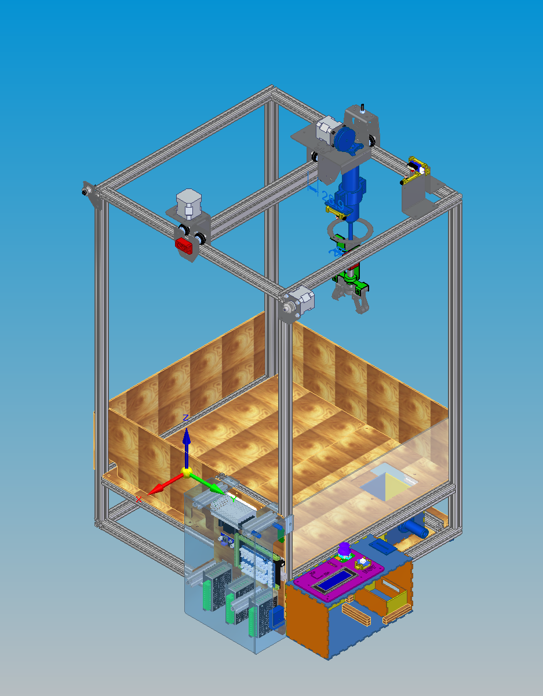
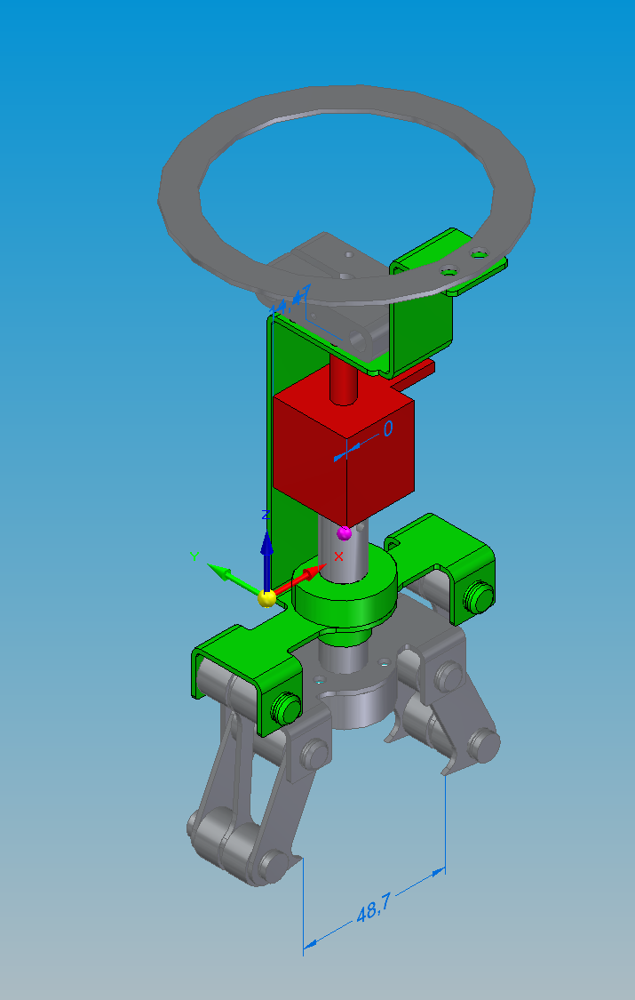

# Machine à pince – Projet P2I 3

Projet de groupe réalisé à l'**INSA Lyon** (P2I 3 – Projet C) : conception, fabrication et industrialisation d'une machine à pince de fête foraine (« claw machine ») à 3 axes X / Y / Z, avec pince à électro-aimant, capteurs de fin de course, électronique Arduino et interface joueur.

**Équipe :** Perraud · Poirier · Vignon · Nicolas



## Une conception de A à Z

Ce projet couvre **toute la chaîne de développement d'un produit**, de l'idée jusqu'à la machine construite et fonctionnelle, puis jusqu'à son industrialisation :

1. **Conception mécanique** en CAO sous Solid Edge (bâti, axes, pince, capteurs, intégration de l'électronique).
2. **Programmation** de la machine en Arduino.
3. **Fabrication** des pièces sur les machines de l'atelier (FAO, usinage, découpe laser, pliage, impression 3D) puis **assemblage** et tests.
4. **Analyse industrielle complète** : étude de la production en série de la machine dans une usine, jusqu'au calcul de son prix de vente (voir [plus bas](#analyse-industrielle)).

### Mon rôle

- **Code Arduino** : programmation de la machine (pilotage des 3 moteurs pas-à-pas X / Y / Z, prise d'origine via les capteurs de fin de course, lecture du joystick et du bouton, commande de l'électro-aimant de la pince, affichage sur l'écran LCD).
- **Conception 3D de la pince** : modélisation complète sous Solid Edge du mécanisme de préhension (griffes, bielles, électro-aimant, pièces de tôlerie, axes).
- **Programmation de la fabrication (FAO)** : conversion des modèles Solid Edge en programmes d'usinage avec **Solid Edge CAM Pro**, pour le **fraisage** et le **tournage** des axes de la pince sur machines-outils.

## La pince construite

> 🎥 *Vidéo de la pince en fonctionnement — à venir.*

## Le projet

L'objectif était de concevoir une machine fonctionnelle et fabricable dans laquelle le joueur pilote une pince au joystick pour attraper un lot dans le plateau de jeu, puis le déposer dans la trappe de sortie.

La machine se décompose en plusieurs sous-ensembles :

| Sous-ensemble | Dossier | Description |
|---|---|---|
| **Bâti** | `FINAL/bati` | Cadre en profilés aluminium 20×20 (540×500), plateau de jeu en MDF, protections en plexiglas, tiroir de récupération, pieds |
| **Axe X** | `FINAL/Axe_x` | Chariot entraîné par moteur pas-à-pas NEMA 17 et courroie GT2, guidé sur rail par des galets |
| **Glissière** | `FINAL/glissière` | Galets sur roulements (625) roulant dans les rainures du profilé 20×40 |
| **Support pince / axe Z** | `FINAL/support pince` | Tôles pliées supportant le treuil (moteur Z + poulie à rainure) qui monte et descend la pince |
| **Pince** | `FINAL/Pince` | Pince à 3 griffes actionnée par électro-aimant via un système bielle-griffe |
| **Canne télescopique** | `FINAL/canne à pêche` | Tube télescopique guidant la pince verticalement et l'empêchant de tourner |
| **Capteurs** | `FINAL/Capteur` | Micro-switchs Grove de fin de course pour la prise d'origine des axes X, Y et Z |
| **Électronique** | `FINAL/bati/platine_compo` | Arduino Mega 2560 + shield Grove, drivers micro-pas, convertisseur LM2596, module relais (électro-aimant), alimentation |
| **Interface joueur** | `FINAL/bati/interface utilisateur finale` | Boîtier à créneaux avec joystick KY-023, bouton Grove et écran LCD 4 lignes I²C |

L'assemblage général est `Pince_finale/assemblage final.asm`.

## La pince



La pince est le cœur du projet :

- **Actionnement par électro-aimant** (bloc rouge) : en tirant l'axe central, il entraîne les **bielles** qui referment les **3 griffes** autour du lot ; au relâchement, la pince s'ouvre.
- Ouverture des griffes d'environ **49 mm**, adaptée à la taille des lots.
- Pièces en **tôlerie pliée** (pièces vertes : pièce haute, pièce basse) pour rester légères et faciles à fabriquer.
- Axes Ø8 mm et entretoises pour les liaisons pivot.
- Une **butée** déclenche le capteur Z pour détecter la position haute.

## Fabrication des axes de la pince (FAO)

Les axes de la pince (axes Ø8 mm, axe reliant l'électro-aimant à la pince, guidages) ont été usinés à partir des modèles 3D :

1. Modélisation de la pièce sous Solid Edge.
2. Création des opérations d'usinage dans **Solid Edge CAM Pro** (choix des outils, trajectoires, conditions de coupe).
3. Simulation puis génération du programme pour la machine-outil (**tour** et **fraiseuse**).
4. Usinage des pièces et montage sur la pince.

## Code Arduino

> 💻 *Le code source Arduino sera ajouté prochainement dans le dossier `arduino/`.*

Le programme tourne sur l'**Arduino Mega 2560** et gère :

- le déplacement de la pince en X / Y au joystick et la descente / remontée en Z ;
- la prise d'origine des axes grâce aux micro-switchs de fin de course ;
- la fermeture / l'ouverture de la pince par l'électro-aimant (via le module relais) ;
- le déroulement d'une partie et l'affichage sur l'écran LCD.

## Analyse industrielle

En parallèle de la conception, l'équipe a mené une **étude complète d'industrialisation** : comment produire cette machine en série dans une usine ayant la surface et le parc machines de l'atelier FIMI de l'INSA Lyon.

**Hypothèses de départ**

- Production de **2 500 machines par an**, soit environ **11 machines par jour** sur 229 jours travaillés.
- Travail en **1×8**, sans sous-traitance des pièces (la platine électronique est achetée toute faite).
- Machine vendue **en pièces détachées**, avec une notice d'assemblage.

**Démarche**

| Étape | Contenu |
|---|---|
| **Statut de l'entreprise** | Choix d'une **SAS** (responsabilité limitée, statuts flexibles, entrée d'investisseurs facilitée) |
| **Nomenclature** | Produit découpé en modules codifiés (axe X, bâti, pince, galets, support pince, canne, capteurs), avec pour chaque pièce la machine utilisée et le temps de fabrication **chronométré** |
| **Dimensionnement de l'atelier** | Calcul du nombre de machines nécessaires (`temps × 11 / 8 h`) : achat et revente de machines-outils (tour CN, fraiseuse, découpeuses laser, plieuses, imprimantes 3D…) — opération autofinancée |
| **Implantation** | Réorganisation de l'atelier en **job-shop** (îlots tôlerie, tournage/fraisage, profilés, impression 3D) avec l'îlot de montage au centre |
| **Personnel** | **24 salariés**, salaires fixés selon la grille de la Convention collective de la métallurgie, charges patronales incluses |
| **Coûts de production** | Matières premières : **357,83 € par machine** (≈ 894 600 €/an) ; énergie, eau, amortissement sur 10 ans et maintenance : ≈ 43 500 €/an |
| **Services et normes** | RH externalisée, salle de repos, tickets restaurant, ménage (avec étude de rentabilité d'une autolaveuse), vestiaires, durée du travail, hygiène et sécurité |
| **Assurances et certifications** | RC pro, vérifications électriques **Q18 / Q19** (thermographie), sécurité incendie **Q4** — devis obtenus auprès d'entreprises |
| **Notice d'assemblage** | Notice visuelle type « Lego », 100 % numérique via QR code (choix économique et écologique) |
| **Fiscalité** | Impôt sur les sociétés, CFE, TVA |

**Résultat :** un prix d'équilibre de **888 €**, porté à **932,40 €** avec une marge de 5 % pour sécuriser et financer le développement de l'entreprise.

## Technologies et composants

- **CAO** : Solid Edge
- **FAO** : Solid Edge CAM Pro (fraisage et tournage)
- **Programmation** : Arduino (C/C++)
- **Structure** : profilés aluminium 20×20 / 20×40, MDF, PMMA (plexiglas), tôle pliée
- **Motorisation** : 3 moteurs pas-à-pas NEMA 17, courroies et poulies GT2
- **Commande** : Arduino Mega 2560, shield Grove, drivers micro-pas, relais
- **Interface** : joystick KY-023, bouton Grove, écran LCD I²C 4 lignes

## Ouvrir les fichiers

Les fichiers sont au format natif **Solid Edge**. Ouvrir `Pince_finale/assemblage final.asm` en conservant l'arborescence des dossiers pour que les liens entre pièces et assemblages restent valides.

```
Pince_finale/
├── assemblage final.asm      ← assemblage général
└── FINAL/
    ├── Axe_x/
    ├── bati/
    ├── canne à pêche/
    ├── Capteur/
    ├── glissière/
    ├── Pince/
    └── support pince/
```
